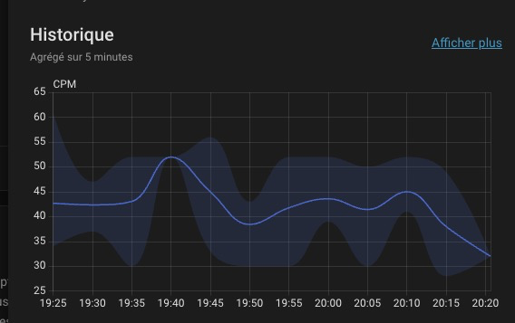
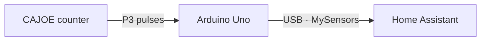

# Geiger MySensors USB

Bring a CAJOE RadiationD-v1.1 Geiger counter into Home Assistant with an
Arduino Uno and a USB cable. Track counts per minute (CPM), react to pulse-count
increases, and watch bytes generated from physical pulse timing.

[Releases and downloads](https://github.com/guilhem/geiger-mysensors/releases/latest) ·
[Software checks](https://github.com/guilhem/geiger-mysensors/actions/workflows/check.yml)

*Actual CPM history in Home Assistant; the interface shown is in French.*

## What you need

- CAJOE RadiationD-v1.1 counter and a 5 V, 16 MHz Uno with an ATmega328P
  and Arduino bootloader.
- Three signal/power leads and a USB **data** cable.
- Home Assistant with USB serial access and its built-in MySensors integration.
- A Home Assistant OS host or Mac for uploading the firmware. No Arduino IDE,
  radio module, MQTT broker, or custom integration is required.

## Get started

1. Open [Releases](https://github.com/guilhem/geiger-mysensors/releases/latest)
   for the application `GeigerMySensors.hex`, full `GeigerMySensors-*.zip`
   archive, `SHA256SUMS`, and `manifest.json`. Build outputs are not tracked in
   this repository.
2. Follow the upload guide for [Home Assistant OS](docs/install-home-assistant-os.md)
   or [macOS](docs/install-macos.md), including checksum and upload verification.
   Uploading replaces the Uno's program; save any existing program you need.
3. Disconnect power and [wire the counter](#wiring), then connect USB to the
   Home Assistant host.
4. Add MySensors with protocol **2.3** and **115200 baud**, following the
   [Home Assistant guide](docs/home-assistant.md).

**Recognize success:** Geiger Ticks starts at `0` and rises with captured pulses.
Radiation CPM gets its first reading after a complete **60 seconds**. Random Byte
and Random Samples appear after eight accepted bits, requiring at least 32 pulses;
at 43 CPM, roughly 45 seconds per byte is an estimate, not a deadline.

## Use it in Home Assistant

- **Radiation CPM:** view history and native measurement statistics.
- **Geiger Ticks:** use counter increases in automations; updates can group pulses.
- **Random Byte / Random Samples:** observe the latest byte (`0`–`255`) and count
  completed bytes, including consecutive identical values.

The [Home Assistant guide](docs/home-assistant.md#history-and-dashboard) shows how
to apply the supplied metadata and dashboard examples: a gauge, five-minute
mean/min/max statistics, and the standard more-info history dialog. No HACS needed.
See [randomness](docs/randomness.md) before using the byte output.

## Wiring

Disconnect both boards from power first. The counter generates several hundred
volts around the tube: avoid that section and keep it enclosed.

| CAJOE P3 marking | Uno connection | Purpose |
|---|---|---|
| `5V` | `5V` | Power from the Uno |
| `GND` | `GND` | Common ground |
| `VIN` | Digital **D2** | Pulse signal, despite the marking |

The Uno's **Vin power input is not used**. Power the assembly only through Uno
USB; disconnect the counter's barrel-jack supply. Leave P100 open: this project
uses P3, not the audio jack. Use female-to-male Dupont leads for the documented
headers. Confirm your board's pin labels and 0–5 V signal compatibility;
this wiring is based on the board family, not electrical qualification of every
revision.

## Go further

- [Home Assistant setup, upgrades, and delivery limits](docs/home-assistant.md)
- [Timing-based randomness and its limits](docs/randomness.md)
- [Build, test, and package the firmware](docs/development.md)
- [Physical installation checks](docs/hardware-validation.md)

CPM is a pulse rate, not a calibrated dose reading. No dose conversion or radiation
alarm is supplied. Connection and stale-value limits are covered in the
[Home Assistant guide](docs/home-assistant.md#delivery-and-failure-behavior).

The application is [GPL-2.0-only](LICENSE). [NOTICE](NOTICE) preserves the original
counter example's attribution and MIT notice; release archives include the
corresponding MySensors and Arduino AVR sources.
